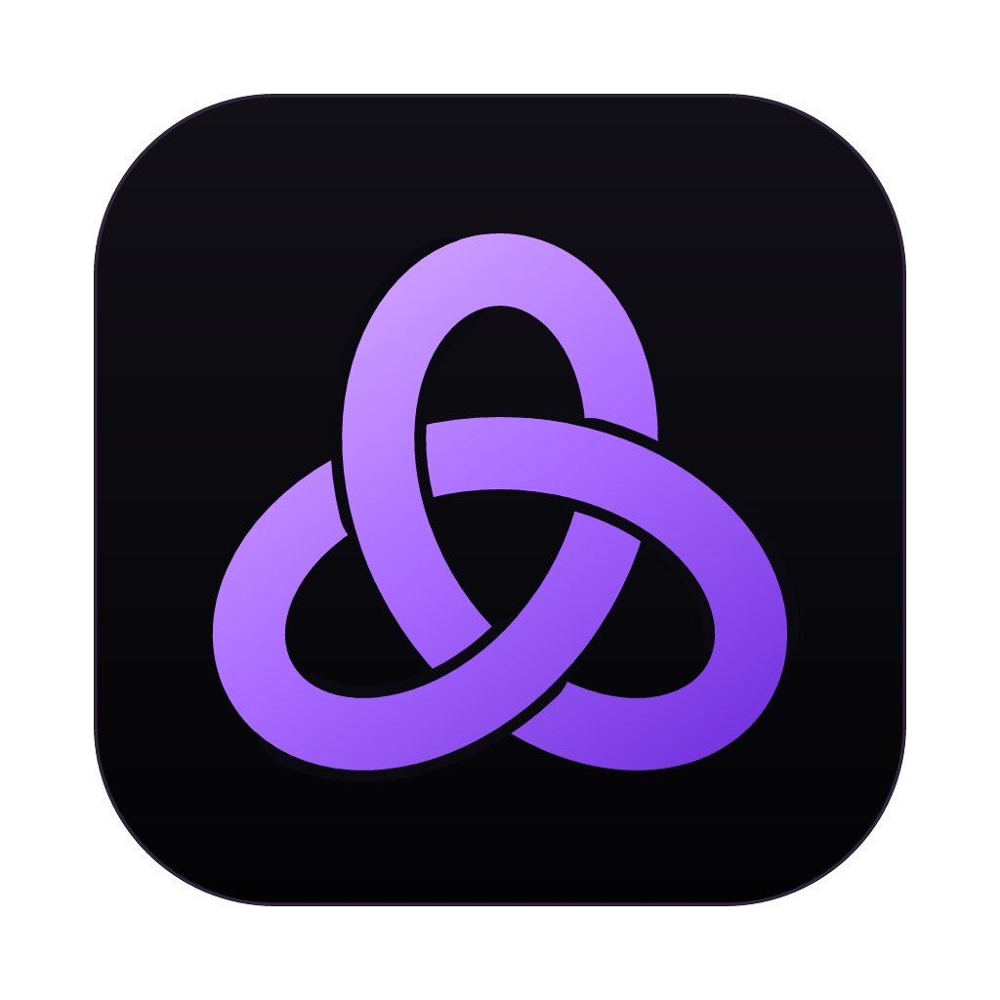

<div align="center">



# Neutron

**A GPU-accelerated file manager for macOS engineers — local APFS speed, remote SFTP power, Git & CI awareness, and AI-native tooling in one binary.**

[](Cargo.toml)
[-000000.svg?style=flat-square&logo=apple)](#building--installing)
[](#architecture)
[](LICENSE)

*100,000 files enumerated and natural-sorted in **160 ms** (`4.8×` faster than `ls -la`) · Pitch-black Stratus UI · Zero UI-thread blocking*

</div>

---

## Why Neutron?

**Finder** is great for casual browsing, yet developers still end up juggling five separate windows — `Finder`, `Terminal`, `Transmit`/`Cyberduck`, `DaisyDisk`, and `git status` — the moment work spans remote servers, massive build directories, or datasets.

**Neutron** unifies your entire local and multi-machine workflow inside a single `wgpu`-accelerated workspace where **nothing ever touches disk or network on the paint thread**.

### Neutron vs. macOS Finder

| Capability | macOS Finder | Neutron |
|---|---|---|
| **100,000-file directory load** | Stalls UI / beachballs on dense dirs | **145.1 ms** bulk kernel enum (`getattrlistbulk`) + **14.9 ms** columnar sort on worker thread |
| **Pane layout** | Tabs only | Arbitrarily nested **split panes** with cross-pane drag-and-drop tabs & dividers |
| **Remote hosts (SFTP/FTP/FTPS)** | Read-only Finder mounts or fragile disconnects | Warm **SSH session pool**, **256 KiB** chunk pipelining, server↔server sync, live **Storage Dashboard** |
| **Repo & CI awareness** | None | Background **Git + Neutrino (`ntr`)** branch, ahead/behind, dirty dots, CI run & PR pills |
| **Disk usage breakdown** | Slow "Get Info" folder sizing | **Interactive Storage Lens** with `target/`/`node_modules/` cache flags & remote `du` support |
| **Directory comparison & sync** | Terminal `rsync` / `diff -rq` | Built-in **Split-Pane Diff & Smart Sync (`⌥⌘D`)** across local ↔ remote ↔ remote |
| **Built-in file viewer** | Quick Look | Tabbed **PDF, Image, Code (40+ langs), Rendered Markdown, CSV/Parquet, SafeTensors/GGUF/ONNX** |
| **Terminal & AI integration** | Separate app | Embedded **PTY shell (`⌃` `)**, remote SSH shell, **Claude Code & Antigravity** with `neutron --mcp` |

---

## Highlights

### Stratus UI & Zero-Stall Architecture
- **Pitch-black borderless Stratus default** (`#000000` canvas, subtle elevation, Lucide action rail), plus **6 additional built-in palettes** (Obsidian, Midnight, Graphite, Catppuccin, Gruvbox, Light) cycled via `⌘D`.
- **4 native views** per tab: List (`⌘2`), Grid (`⌘1`), Miller Columns (`⌘3`), and Gallery (`⌘4`), with instant in-memory substring filtering (`⌘F`) and fuzzy finder (`⌘P`).
- **78.8 MiB idle RAM, 0.0% idle CPU**, zero background animation timers when untouched.

### Remote SFTP Power Engine & Dual-Boot Storage
- **Dashboard host storage cards** probe macOS (`df`), Linux (`/run/media/*`), and Windows (`fsutil`) volumes over SFTP, including dual-boot hosts sharing an IP.
- **Persistent multiplexed SSH pool** reuses warm authenticated connections with key/credential verification before lookup and automatic single-retry recovery.
- **Full bidirectional transfers**: `⌘C` / `⌘X` / `⌘V` across local ↔ remote and **server ↔ server**, plus a concurrent transfer queue showing live `MB/s` throughput and per-job cancellation.
- **Remote parity**: Server-side search (`⌘P` via `find`/`Get-ChildItem`), on-demand remote folder sizes, cached remote thumbnails, and one-click SSH shell tabs (`⌃` `).

### Git & Neutrino (`ntr`) Awareness
- Repositories opened locally or over SFTP automatically resolve branch state (`↑ahead ↓behind`, dirty count) and **Neutrino (`ntr`)** CI runs, open PR counts, and mirror health in the pane header — alongside per-row tonal status dots (`Modified`, `Added`, `Untracked`, `Conflicted`).
- Right-click or Command Palette (`⇧⌘P`) actions: **Copy Git Branch**, **Run `ntr status`**, and **Inspect Latest CI Run**.

### Interactive Storage Lens & Split-Pane Diff (`⌥⌘D`)
- Click **Inspect** on any Dashboard volume card (local or remote) to open **Storage Lens**: stacked proportional bar, drill-down sorting, `CACHE` badges on heavy folders (`target`, `node_modules`, `.cache`, `DerivedData`, `.venv`), and two-click **Trash**.
- Press **`⌥⌘D`** with split panes to highlight `ONLY`, `NEWER`, `OLDER`, and `DIFF` items (with 2-second cross-OS mtime tolerance) and click **Sync →** to transfer missing and newer files cleanly.

### Rich Engineering Tab Viewer (`⌥⌘O`)
- **Markdown (`.md`)**: Clean typographic preview with headings, fenced code cards, quotes, and rules — plus a one-click **Rendered / Raw** toggle.
- **Datasets (`.csv`, `.tsv`, `.jsonl`, `.parquet`)**: Virtualized tables with clickable column sorting (`▲` / `▼`), click-to-copy cells, and zero-copy Parquet `PAR1` footer schema inspection.
- **ML Checkpoints (`.safetensors`, `.gguf`, `.onnx`)**: Instant zero-copy / seek-past-weights inspection of parameter totals, dtype breakdown, model metadata, and searchable tensor tables without loading gigabytes of weights into RAM.
- **Code, PDF & Images**: Syntax-highlighted source across 40+ languages with line selection, Core Graphics multi-page PDFs with zoom, and scaled images.

### Workspaces, Terminal & AI Agents
- **Saved Multi-Machine Layouts** (`layouts.json`): Save and switch complete split-pane topologies (including remote SFTP tabs) from the Command Palette.
- **Embedded Terminal (`⌃` `)** & **Ask Claude Code / Ask Antigravity**: Runs directly inside the focused local or SFTP folder, exposing Neutron's Spotlight & fuzzy search tools via `neutron --mcp`.

---

## Measured Performance (Apple M2 Pro)

Measured on **Apple M2 Pro · 16 GiB RAM · macOS 27.0.1** using Neutron's headless benchmark harness (`neutron --bench <path> 8`) and `ps`. See [`docs/perf.md`](docs/perf.md) for methodology and Tailscale SFTP figures.

| Workload | Result | Context |
|---|---|---|
| **Enumerate 100,000 APFS files** | **145.11 ms** warm median (`149.73 ms` cold) | **17.15× faster** than standard `read_dir` + `lstat` (`2,488.90 ms`) |
| **Natural-sort 100,000 entries** | **14.89 ms** warm median | **0.176 µs/entry** over Neutron's columnar `EntryList` |
| **100k Enumerate + Sort vs `/bin/ls -la`** | **160.0 ms** vs **771.0 ms** | **4.8× faster** than `/bin/ls -la > /dev/null` |
| **Enumerate `/usr/bin` (932 entries)** | **3.25 ms** warm median | **10.2× faster** via `getattrlistbulk(2)` |
| **Idle GUI app footprint** | **78.8 MiB RSS · 0.0% CPU** | Single **20 MB** universal binary (`aarch64-apple-darwin`) |

---

## Architecture

> **Core rule:** The UI thread only ever reads plain memory. Every filesystem syscall, `getattrlistbulk` pass, Spotlight query, Git/`ntr` invocation, preview decode, and SSH/SFTP transfer runs off the paint thread and delivers snapshots over bounded/unbounded channels.

```text
crates/
├── neutron-core       Namespace traits, columnar EntryList arena, SortSpec, layout tree
├── neutron-ui         Stratus theme system, virtualized list/grid/columns, rail icons, term view
├── neutron-shell      macOS getattrlistbulk FS, copyfile(3), Trash/Put Back, Quick Look, Tags, PTY
├── neutron-remote     Pooled SSH client (russh), SFTP chunk pipeline, FTP/FTPS transport, volume probes
├── neutron-archive    Unified zip, tar, tar.gz/xz/bz2, 7z, and RAR browsing + extraction
├── neutron-fuzzy      Nucleo-backed incremental fuzzy path & command matcher
├── neutron-index      Background Spotlight & Everything-style volume index client
├── neutron-indexer    Local index worker binary/service
├── neutron-cloud      Google Drive API integration with OS Keychain token storage
├── neutron-plugin     Subprocess plugin runner extending the Command Palette
└── neutron-app        Main application, modularized into src/app/*.rs, viewer formats, VCS & Storage Lens
```

---

## Building & Installing

Requires **macOS 12+**, **Rust 1.85+**, and Xcode Command Line Tools (`xcode-select --install`):

```sh
git clone https://github.com/razeenwasif/neutron.git
cd neutron

# Run the full workspace test suite (935 passing unit tests)
cargo test --workspace --locked

# Build the release macOS app bundle (target/release/Neutron.app)
cargo xtask bundle
open target/release/Neutron.app

# Build & install directly into ~/Applications/Neutron.app
cargo xtask install
```

### CLI Usage

```sh
neutron [path]                   # Open Neutron at a folder (defaults to ~)
neutron --bench <path> [runs]    # Headless enumerate + natural-sort timing
neutron --mcp                    # Serve Neutron search tools over stdio MCP
```

---

## Essential Shortcuts

| Shortcut | Action |
|---|---|
| `⌘1` `⌘2` `⌘3` `⌘4` | Grid, List, Columns, Gallery view |
| `⌘P` / `⇧⌘F` / `⇧⌘P` | Fuzzy file finder / Search Everywhere (Spotlight) / Command Palette |
| `⌘\` / `⇧⌘\` / `F6` | Split pane right / split pane down / cycle pane focus |
| `⌥⌘D` | Compare split panes & Smart Sync |
| `⌘D` / `⇧⌘.` | Cycle theme (7 palettes) / toggle hidden files |
| `⌘K` / `⌃⌘T` | Connect to SFTP/FTP server / pin local or remote folder |
| `⌥⌘O` / `Space` | Open in Rich Tab Viewer / Quick Look |
| ``⌃` `` | Open integrated local or remote SSH terminal |
| `⌘C` `⌘X` `⌘V` `⌘Z` | Clipboard & undoable local file operations (`copyfile(3)` + APFS clones) |

---

## Further Documentation

- [`docs/perf.md`](docs/perf.md) — Apple Silicon (`getattrlistbulk`), Tailscale SFTP, and historical benchmarks
- [`docs/servers.md`](docs/servers.md) — SFTP/FTP setup, host keys, dual-boot drives, and `sites.json`
- [`docs/terminal.md`](docs/terminal.md) — Embedded PTY shell, AI agent integration, and MCP tools
- [`docs/plugins.md`](docs/plugins.md) — Extending Neutron with external plugin commands
- [`docs/status.html`](docs/status.html) — Interactive roadmap, milestone log, and keybinding cheatsheet
